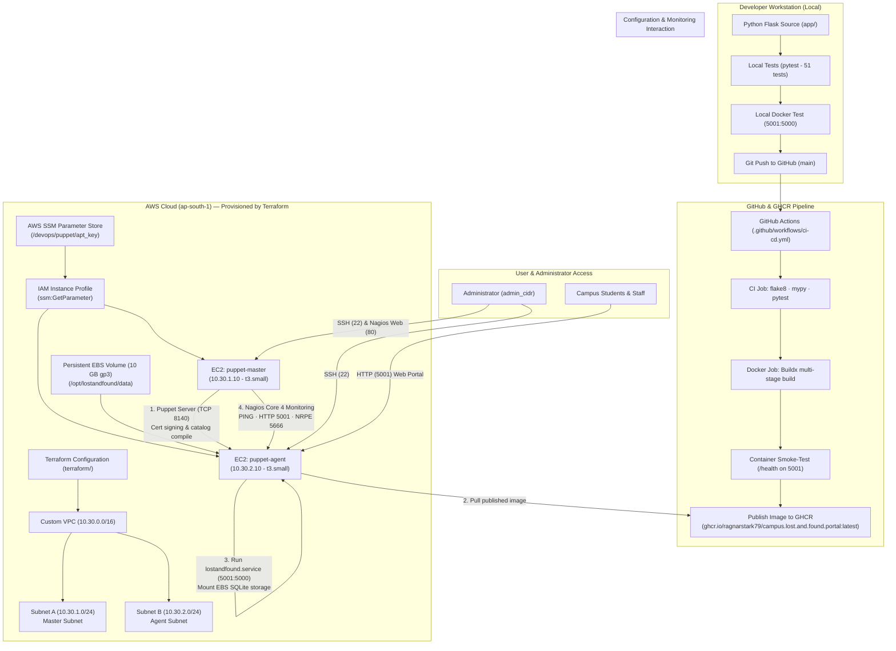
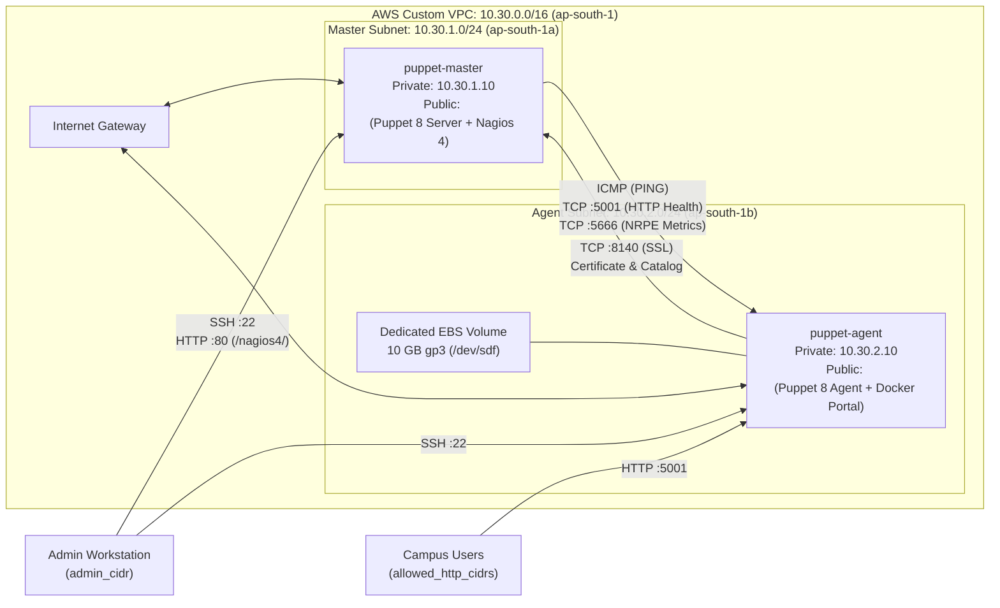
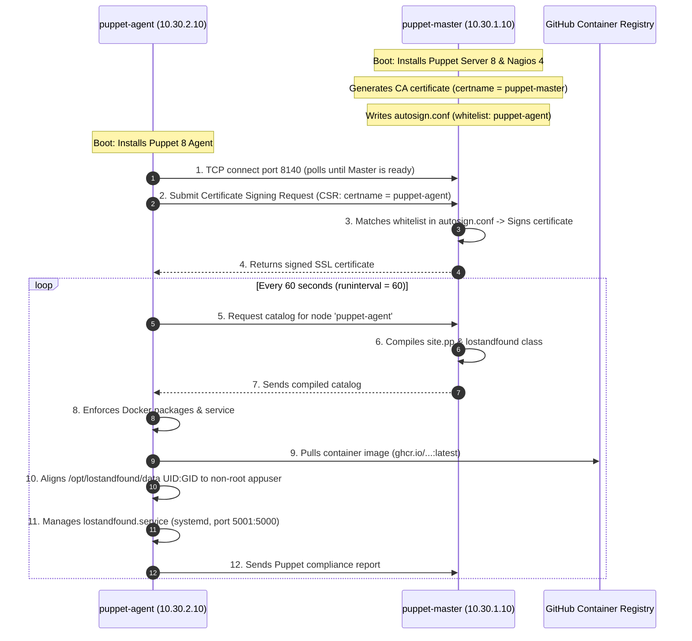
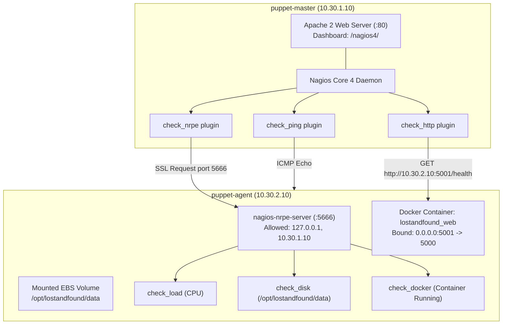

# Revised Project Architecture Specification
## Campus Lost and Found Portal — Automated Deployment & Monitoring

**Project:** Campus Lost and Found Portal
**Course:** INT333 — DevOps Advanced Configuration Management
**Document Version:** 2.0 (Post-Audit Blueprint)
**Status:** Approved Reference Specification
**Target Environment:** AWS EC2 (`ap-south-1` Mumbai)

---

## 1. Architectural Overview

The Campus Lost and Found Portal architecture combines modern infrastructure-as-code, configuration management, containerization, and monitoring into an enterprise-grade academic demonstration.

The system is deployed across **two dedicated AWS EC2 instances** running **Ubuntu 24.04 LTS** in a custom Virtual Private Cloud (VPC):
1. **`puppet-master`**: Central authority hosting **Puppet Server 8** (configuration compiler and CA) and **Nagios Core 4** (central monitoring server with Apache CGI web dashboard).
2. **`puppet-agent`**: Managed compute host running **Puppet 8 Agent**, **Docker Engine CE**, the containerized **Campus Lost and Found Portal** application (`lostandfound_web`), and the **NRPE** monitoring daemon.

Sensitive repository tokens and deployment secrets are isolated inside **AWS Systems Manager (SSM) Parameter Store** as encrypted `SecureString` parameters and accessed via **AWS IAM Instance Profiles**, guaranteeing that zero secrets exist in Git, Terraform state, or user-data logs.

---

## 2. End-to-End System Pipeline



---

## 3. Network Architecture & Security Groups

### 3.1 VPC & Subnet Layout

| Resource | CIDR Block | Availability Zone | Description |
| :--- | :--- | :--- | :--- |
| **VPC** | `10.30.0.0/16` | `ap-south-1` | Dedicated custom VPC with DNS resolution and DNS hostnames enabled. |
| **Internet Gateway (IGW)** | `0.0.0.0/0` | Attached to VPC | Provides internet route for package installation, GHCR pulls, and public access. |
| **Route Table (Public)** | `0.0.0.0/0 -> IGW` | VPC-wide | Direct internet route for all subnets. |
| **Master Subnet** | `10.30.1.0/24` | `ap-south-1a` | Hosts `puppet-master` (Static Private IP: `10.30.1.10`). |
| **Agent Subnet** | `10.30.2.0/24` | `ap-south-1b` | Hosts `puppet-agent` (Static Private IP: `10.30.2.10`). |

### 3.2 Network Topology Diagram



### 3.3 Security Groups & Port Matrix

#### Master Security Group (`master_sg`)

| Direction | Protocol | Port Range | Source / Destination | Purpose / Description |
| :--- | :---: | :---: | :--- | :--- |
| **Ingress** | TCP | `22` | `var.admin_cidr` (`<your-ip>/32`) | Secure SSH administration for the instructor and student. |
| **Ingress** | TCP | `80` | `var.admin_cidr` (`<your-ip>/32`) | Nagios Core Web Dashboard (`/nagios4/`). |
| **Ingress** | TCP | `8140` | `aws_security_group.agent.id` | Puppet Server communication from the Agent node only. |
| **Egress** | ALL | ALL | `0.0.0.0/0` | Outbound access for APT packages, Puppet releases, and OS updates. |

#### Agent Security Group (`agent_sg`)

| Direction | Protocol | Port Range | Source / Destination | Purpose / Description |
| :--- | :---: | :---: | :--- | :--- |
| **Ingress** | TCP | `22` | `var.admin_cidr` (`<your-ip>/32`) | Secure SSH administration for the instructor and student. |
| **Ingress** | TCP | `5001` | `var.allowed_http_cidrs` (`0.0.0.0/0` or campus CIDR) | Public/campus access to the Lost and Found Flask application. |
| **Ingress** | TCP | `5666` | `aws_security_group.master.id` | Nagios NRPE checks strictly from the Master node. |
| **Ingress** | ICMP | `-1` (Echo) | `aws_security_group.master.id` | Nagios ICMP host availability checks (PING) from Master node. |
| **Egress** | ALL | ALL | `0.0.0.0/0` | Outbound access for Docker package repos, GHCR container pulls, and APT. |

---

## 4. Compute, OS & Storage Specifications

| Parameter | `puppet-master` Node | `puppet-agent` Node |
| :--- | :--- | :--- |
| **Operating System** | Ubuntu 24.04 LTS (Noble Numbat) 64-bit | Ubuntu 24.04 LTS (Noble Numbat) 64-bit |
| **AMI Lookup** | Official Canonical `ubuntu-noble-24.04-amd64-server-*` | Official Canonical `ubuntu-noble-24.04-amd64-server-*` |
| **Instance Type** | `t3.small` (2 vCPU, 2 GiB RAM) | `t3.small` (or `t3.micro`) (2 vCPU, 1–2 GiB RAM) |
| **Rationale** | Puppet Server JVM (512 MiB heap) + Nagios + Apache requires 2 GiB to avoid OOM. | Runs lightweight Docker daemon and single Flask container. |
| **Private IP** | `10.30.1.10` (Static) | `10.30.2.10` (Static) |
| **Hostname** | `puppet-master` | `puppet-agent` |
| **Root EBS Volume** | 16 GiB GP3, Encrypted (`delete_on_termination = true`) | 16 GiB GP3, Encrypted (`delete_on_termination = true`) |
| **Secondary Storage** | None | 10 GiB GP3 EBS volume attached at `/dev/sdf` |
| **Mount Point** | N/A | `/opt/lostandfound/data` (Ext4, persistent SQLite storage) |
| **IMDSv2** | Enforced (`http_tokens = "required"`, hop limit `1`) | Enforced (`http_tokens = "required"`, hop limit `1`) |

---

## 5. Security & Credential Architecture

### 5.1 AWS Systems Manager (SSM) Parameter Store

To avoid leaking credentials in Git, Terraform state, or user-data logs, sensitive package repository tokens are managed in AWS SSM:

```text
Parameter Name:  /devops/puppet/apt_key
Parameter Type:  SecureString
Key Management:  Default AWS KMS key (alias/aws/ssm)
Value:           <Your Puppet Core APT API Key / Forge Token>
```

### 5.2 IAM Instance Profile & Least-Privilege Policy

Terraform provisions an IAM Role with an `AssumeRolePolicy` for `ec2.amazonaws.com` attached to an instance profile:

```json
{
  "Version": "2012-10-17",
  "Statement": [
    {
      "Effect": "Allow",
      "Action": [
        "ssm:GetParameter",
        "ssm:GetParameters"
      ],
      "Resource": "arn:aws:ssm:ap-south-1:*:parameter/devops/puppet/*"
    }
  ]
}
```

### 5.3 Automated Decryption & Drop-In at First Boot

During `user_data` bootstrap execution on both nodes:
```bash
if aws ssm get-parameter --name "/devops/puppet/apt_key" --region ap-south-1 >/dev/null 2>&1; then
  PUPPET_API_KEY=$(aws ssm get-parameter --name "/devops/puppet/apt_key" --with-decryption --region ap-south-1 --query "Parameter.Value" --output text)
  mkdir -p /etc/apt/auth.conf.d
  cat > /etc/apt/auth.conf.d/apt-puppetcore-puppet.conf <<EOF
machine apt-puppetcore.puppet.com
login forge-key
password ${PUPPET_API_KEY}
EOF
  chmod 0600 /etc/apt/auth.conf.d/apt-puppetcore-puppet.conf
fi
```
*Note:* If community packages (`apt.puppet.com`) are used without repository auth, the bootstrap script safely detects the parameter's absence and continues without halting.

---

## 6. Puppet 8 Master-Agent Architecture



---

## 7. Nagios Monitoring & Observability Architecture

Nagios Core 4 runs on `puppet-master` and monitors `puppet-agent` over the private network:



### Monitored Services Summary

1. **`PING`**: Tests ICMP reachability between subnets (`check_ping!100.0,20%!500.0,60%`).
2. **`HTTP Application`**: Tests web portal availability on port 5001 (`check_http -p 5001 -u /`).
3. **`HTTP Health`**: Tests application SQLite connectivity (`check_http -p 5001 -u /health`).
4. **`NRPE CPU Load`**: Checks system load averages (`check_nrpe!check_load`).
5. **`NRPE Data Disk`**: Alerts if free disk space on `/opt/lostandfound/data` drops below 20% / 10% (`check_nrpe!check_disk`).
6. **`NRPE Container Status`**: Verifies that the Docker container `lostandfound_web` is in a healthy `running` state.

---

## 8. Implementation Component Classification

| Layer / Feature | Status | Notes / Operational Boundaries |
| :--- | :---: | :--- |
| **Flask Application (`app/`)** | **Already Implemented** | Complete CRUD, filtering, SQLite models, 51/51 pytest passing. |
| **Dockerfile & Compose** | **Already Implemented** | Multi-stage build, non-root `appuser`, healthcheck, port 5001:5000. |
| **GitHub Actions Pipeline** | **Already Implemented** | `.github/workflows/ci-cd.yml` configured and syntax-validated with `act`. |
| **GHCR Remote Publication** | **Complete** | Successfully published via GitHub Actions run `43176357332` (`latest` and `sha-0bf459f`). |
| **Terraform 2-Node Topology** | **Planned (Phase 3)** | Requires authoring custom VPC, subnets, IAM role, SSM, and 2 EC2 instances. |
| **Puppet 8 Master-Agent** | **Planned (Phase 4)** | Requires authoring Puppet Server setup, autosigning, and client-server catalog manifests. |
| **Application Deploy Module** | **Planned (Phase 5)** | Porting `lostandfound` class to the master module path with Docker and systemd. |
| **Nagios Core & NRPE** | **Planned (Phase 6)** | Requires Nagios 4 installation, Apache CGI, host/service configs, and NRPE. |
| **AWS Account Credentials** | **External Prerequisite** | AWS CLI profile or environment credentials on developer workstation. |
| **SSM Parameter Creation** | **Manual User Operation** | Running `aws ssm put-parameter` once before executing `terraform apply`. |
| **Infrastructure Deployment** | **Manual User Operation** | User approval required before executing `terraform apply` or `terraform destroy`. |
